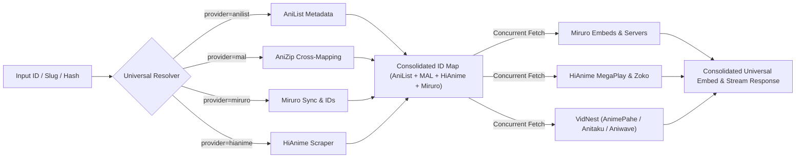

# 🌌 HiAnime Unofficial API by Senkai Sora — High-Performance Anime Scraper & Stream Extraction Engine

[](https://expressjs.com/)
[](https://www.typescriptlang.org/)
[](https://nodejs.org/)
[](https://bun.sh/)
[](https://cheerio.js.org/)
[](https://axios-http.com/)
[](LICENSE)

**Hianime Unofficial Api by Senkai Sora** is a high-performance, structured anime scraping and streaming extraction engine built with **Express.js**, **TypeScript**, and **Cheerio**. It transforms [hianime.ba](https://hianime.ba) data into type-safe REST APIs and features stream extractors capable of resolving direct Master `.m3u8` playlists, VTT subtitle tracks, and intro/outro timestamps with AES-256-CBC decryption.

---

## 📑 Table of Contents

- [Features](#-features)
- [Architecture Overview](#-architecture-overview)
- [Interactive GitBook Documentation & Console](#-interactive-gitbook-documentation--console)
- [Getting Started](#-getting-started)
- [Environment Variables](#-environment-variables)
- [Stream Extraction & AES-256 Decryption](#-stream-extraction--aes-256-decryption)
- [API Reference & Endpoints (HiAnime)](#-api-reference--endpoints)
  - [1. HiAnime Home Feed](#1-hianime-home-feed)
  - [2. Estimated Anime Schedule](#2-estimated-anime-schedule)
  - [3. Anime Details](#3-anime-details)
  - [4. Anime Episodes List](#4-anime-episodes-list)
  - [5. Episode Streaming Servers](#5-episode-streaming-servers)
  - [6. Episode Downloads](#6-episode-downloads)
  - [7. ZokoAnime Stream Extractor](#7-zokoanime-stream-extractor)
  - [8. HD-1 (MegaPlay) Stream Extractor](#8-hd-1-megaplay-stream-extractor)
  - [9. AnimePahe (VidNest) Direct Stream Extractor](#9-animepahe-vidnest-direct-stream-extractor)
  - [10. Anitaku Stream Extractor](#10-anitaku-stream-extractor)
  - [11. Aniwave Stream Extractor](#11-aniwave-stream-extractor)
  - [12. Anime Sync (HiAnime Anime ID -> AniList Metadata)](#12-anime-sync-hianime-anime-id---anilist-metadata)
  - [13. AniList Reverse Sync (AniList ID -> HiAnime Data)](#13-anilist-reverse-sync-anilist-id---hianime-data)
  - [14. Category & Listing Feeds (Subbed, Dubbed, Movies, TV, OVAs, ONAs, Specials, Popular)](#14-category--listing-feeds)
  - [15. Random Anime](#15-random-anime)
  - [16. Instant Search Suggestions](#16-instant-search-suggestions)
  - [17. Search Anime Catalog with Filters](#17-search-anime-catalog-with-filters)
  - [18. Dedicated Filter Engine & Options](#18-dedicated-filter-engine--options)
  - [19. Genre Filter](#19-genre-filter)
  - [20. A–Z Catalog Directory](#20-az-catalog-directory)
  - [21. Mirrors & Failover Status](#21-mirrors--failover-status)
  - [22. Service Diagnostics & Health](#22-service-diagnostics--health)
- [MyAnimeList (MAL - Jikan) API Provider](#-myanimelist-mal---jikan-api-provider)
- [AniList (GraphQL) API Provider](#-anilist-graphql-api-provider)
- [Miruro.to API Provider](#-miruroto-api-provider)
- [Universal Embed & Stream Aggregator](#-universal-embed--stream-aggregator)
- [AniSkip Intro & Outro Timestamps](#-aniskip-intro--outro-timestamps)
- [Project Structure](#-project-structure)
- [Deployment](#-deployment)
- [License & Disclaimer](#-license--disclaimer)

---

## ⚡ Features

- **🚀 Ultra-Fast Server-Side Scraping:** Utilizes Cheerio and persistent Axios HTTP agents with zero headless browser overhead, achieving sub-second responses.
- **🛡️ Native AES-256-CBC Decryption:** Deobfuscates encrypted video source payloads (`enc`) from server `HD-1` (`megaplay.buzz`) with built-in cryptographic primitives.
- **🎬 Direct HLS (M3U8) & Subtitles:** Extracts direct multi-bitrate Master `.m3u8` streams, `.vtt` subtitle files, and precise intro/outro skip intervals for ZokoAnime and MegaPlay servers.
- **🔓 Base64 Server Decoding:** Automatically decodes Base64 stream URLs into direct playable stream embeds for Sub, Dub, and Raw categories.
- **🖥️ AdminLTE Interactive Frontpage:** Sleek AdminLTE dark-mode testing console available directly at root (`GET /`) for one-click endpoint testing and raw JSON inspection.
- **🔍 Typeahead & Deep Search:** Real-time search suggestions with poster cards, comprehensive catalog search with full pagination, and genre / A–Z catalog browsing.
- **🪞 Automatic Multi-Mirror Failover:** Main site `https://hianime.at` with automated sequential failover across 5 mirrors (`hianime.ba`, `hianime.gy`, `hianime.lu`, `hianime.tr`, `hianimetv.bz`). If the main site or active mirror experiences downtime or blocking, requests automatically route to the next available mirror without interruption.
- **📦 Dual Runtime Support:** Compatible with both Node.js (v18+) and Bun (v1.4+) for fast cold starts and development.
- **🌐 Full CORS & JSON Ready:** Ready to be consumed by Next.js, React, React Native, Flutter, Swift, or Android applications.

---

## 🏗️ Architecture Overview

```mermaid
flowchart TD
    Client[Client App / Browser / Mobile Frontend] -->|HTTP Request| Express[Express.js Server]
    Express --> Router[Router /api/v1/hianime]
    
    subgraph Core Engine [Senkai Sora Core Engine]
        Router --> Controllers[Controllers & Validation]
        Controllers --> Extractors[Cheerio Extractors]
        Extractors --> Service[Scraper Service / Axios Agent]
        Extractors --> Crypto[AES-256-CBC Decryptor]
    end

    subgraph Upstream Targets [Upstream Streaming Targets]
        Service -->|Scrape HTML & API| HiAnime[HiAnime.ba]
        Service -->|Extract HLS & VTT| Zoko[ZokoAnime.video]
        Crypto -->|Decrypt getSources| MegaPlay[MegaPlay.buzz HD-1]
    end

    Core Engine -->|Structured JSON / AdminLTE UI| Client
```

---

## 🖥️ Interactive GitBook Documentation & Console
 
The root path (`GET /`) serves a modern, **GitBook-inspired** dark developer documentation portal and live interactive testing console:
 
- **Sidebar Treeview Navigation**: Browse all endpoints grouped by category (**Getting Started**, **Core: Stream Proxy & ID Mappings**, **Provider: Anime -> HiAnime**, **Provider: Meta -> AniList**, and **Provider: Stream -> All Providers**).
- **Quickstart & Guided Setup**: Step-by-step local clone, dependency install, container run commands, and status checks.
- **Interactive Live Request Console**: Select any preset (AniList sync, HiAnime details, AnimePahe/Anitaku/Aniwave streams), edit parameters, and send requests directly to the running backend.
- **Real-Time Diagnostics**: Displays HTTP status pills (e.g. `200 OK`), request duration (`ms`), and a syntax-highlighted, foldable JSON response viewer with 1-click clipboard copy.
- **Sticky "On This Page" TOC**: Real-time scroll indicator highlighting the active section.
- **Search Modal (`Ctrl + K`)**: Instant search across all API endpoints, routes, and guides.
 
> [!NOTE]
> When requesting `GET /` with header `Accept: application/json` or query parameter `?format=json`, the server automatically returns the raw JSON endpoint directory for programmatic consumers.

---

## 🚀 Getting Started

### Prerequisites

- [Node.js](https://nodejs.org/) v18.18.0 or later *(or [Bun](https://bun.sh/) v1.4.0+)*
- npm, yarn, or bun package manager

### Installation

```bash
# Clone repository
git clone https://github.com/NicoLoop/anime-stream-gb.git
cd anime-stream-gb/api

# Install dependencies
npm install
# or with Bun:
bun install
```

### Running Locally

```bash
# Start in development mode with hot reload
npm run dev

# Or with Bun:
npm run dev:bun

# Compile TypeScript to dist/
npm run build

# Start production server
npm start
```

Open [http://localhost:4000](http://localhost:4000) in your browser to access the AdminLTE API testing console.

---

## ⚙️ Environment Variables

Create a `.env` file in the `api/` root directory (or copy `.env.example`):

```env
# Server Port (Default: 4000)
PORT=4000

# Main Upstream Base URL (Default: https://hianime.at)
BASE_URL=https://hianime.at

# Comma-separated list of failover mirrors
MIRRORS=https://hianime.ba,https://hianime.gy,https://hianime.lu,https://hianime.tr,https://hianimetv.bz
```

---

## 🎬 Stream Extraction & AES-256 Decryption

The API includes specialized direct stream extractors:

### 1. HD-1 (MegaPlay) Cryptographic Decryption
- **Embed URL**: `https://megaplay.buzz/stream/s-2/2142/sub?s=tcdn`
- **Internal Payload**: Player embeds `<div id="megaplay-player" data-id="...">` which calls `https://megaplay.buzz/stream/getSources?id=...`.
- **Cipher**: Returns an obfuscated ciphertext (`enc`) encrypted using **AES-256-CBC**.
- **Decryption Engine**: Automatically derives key and IV, performs URL-safe Base64 padding normalization, and outputs decrypted JSON containing the direct Master `.m3u8` playlist URL and subtitle tracks.

### 2. ZokoAnime Payload Deobfuscation
- **Embed URL**: `https://zokoanime.video/stream/mal/21/1/sub`
- **Extractor**: Extracts video source objects, Master HLS streams, webvtt subtitle tracks (`.vtt`), and auto-skip ranges for anime intros and outros.

---

## 📡 API Reference & Endpoints

### 1. HiAnime Home Feed
- **Method**: `GET`
- **URL**: `/api/v1/hianime/home`
- **Description**: Returns all sections from HiAnime's homepage (`https://hianime.ba/home`), including spotlight sliders, trending anime, latest episodes, upcoming releases, top airing, top 10 (day, week, month), and genres.

#### Sample Response:
```json
{
  "success": true,
  "data": {
    "spotlightAnimes": [
      {
        "rank": 1,
        "id": "black-clover-season-2-1-10492",
        "name": "Black Clover Season 2",
        "jname": "Black Clover 2nd Season",
        "poster": "https://hianime.ba/storage/media/2026/10/black-clover-season-2-1-banner.webp",
        "description": "The second season of Black Clover.",
        "type": "TV",
        "duration": "Oct 5, 2026",
        "aired": "Oct 5, 2026",
        "quality": "HD",
        "episodes": {
          "sub": 3,
          "dub": 1,
          "eps": 3
        }
      }
    ],
    "trendingAnimes": [
      {
        "rank": 1,
        "id": "one-piece-1",
        "name": "One Piece",
        "jname": "One Piece",
        "poster": "https://hianime.ba/storage/media/2026/08/one-piece.webp"
      }
    ],
    "latestEpisodeAnimes": [ ... ],
    "topUpcomingAnimes": [ ... ],
    "topAiringAnimes": [ ... ],
    "mostPopularAnimes": [ ... ],
    "mostFavoriteAnimes": [ ... ],
    "latestCompletedAnimes": [ ... ],
    "top10Animes": {
      "today": [ ... ],
      "week": [ ... ],
      "month": [ ... ]
    },
    "genres": [ "Action", "Adventure", "Comedy", "Drama", "Fantasy", ... ]
  }
}
```

---

### 2. Estimated Anime Schedule
- **Method**: `GET`
- **URL**: `/api/v1/hianime/schedule` *(or `/api/v1/hianime/anime/schedule`)*
- **Query Parameters**:
  - `date` *(optional)*: Specific date in `YYYY-MM-DD` format (e.g. `2026-10-18`). Defaults automatically to the active / current day in the schedule widget.
  - `tzOffset` *(optional)*: Timezone offset in minutes (e.g., `-360` for UTC+6, `0` for UTC, `300` for UTC-5). Defaults to `0`.
- **Examples**:
  - `/api/v1/hianime/schedule`
  - `/api/v1/hianime/schedule?tzOffset=-360`
  - `/api/v1/hianime/schedule?date=2026-10-18&tzOffset=-360`
- **Description**: Scrapes the interactive broadcast schedule from `https://hianime.at/home`. Returns the broadcast time, scheduled airing episode number, title, and anime ID for each scheduled show, as well as the list of 29-day schedule date tabs (`availableDates`).

#### Sample Response:
```json
{
  "success": true,
  "data": {
    "date": "2026-10-18",
    "tzOffset": -360,
    "availableDates": [
      {
        "date": "2026-10-18",
        "dayOfWeek": "Sun",
        "displayDate": "Oct 18",
        "isActive": true
      },
      {
        "date": "2026-10-19",
        "dayOfWeek": "Mon",
        "displayDate": "Oct 19",
        "isActive": false
      }
    ],
    "scheduledAnimes": [
      {
        "id": "blue-box-season-2-7182",
        "time": "17:00",
        "name": "Blue Box Season 2",
        "jname": "Ao no Hako 2nd Season",
        "airingEpisode": "Episode 3",
        "episodeNumber": 3
      },
      {
        "id": "kanata-kara-c16d8-10503",
        "time": "21:00",
        "name": "Kanata kara",
        "jname": "Kanata kara",
        "airingEpisode": "Episode 3",
        "episodeNumber": 3
      }
    ]
  }
}
```

---

### 3. Anime Details
- **Method**: `GET`
- **URL**: `/api/v1/hianime/anime/:id` *(or `/api/v1/hianime/animeDetails/:id`)*
- **Example**: `/api/v1/hianime/anime/one-piece-1`
- **Description**: Returns complete details for an anime including overview, stats, japanese/romaji title, poster, genres, producers, studios, recommended anime, related anime, and numeric `animeId`.

#### Sample Response:
```json
{
  "success": true,
  "data": {
    "id": "one-piece-1",
    "animeId": "1",
    "name": "One Piece",
    "jname": "ONE PIECE",
    "poster": "https://hianime.ba/storage/media/2026/08/one-piece.webp",
    "description": "Gold Roger was known as the 'Pirate King'...",
    "stats": {
      "rating": "PG-13",
      "quality": "HD",
      "type": "TV",
      "duration": "24m",
      "episodes": {
        "sub": 1180,
        "dub": 1155,
        "eps": 1180
      }
    },
    "moreInfo": {
      "japanese": "ONE PIECE",
      "synonyms": null,
      "aired": "Oct 20, 1999 to ?",
      "premiered": null,
      "duration": "24m",
      "status": "Currently Airing",
      "malScore": "8.73",
      "genres": ["Adventure", "Fantasy", "Shounen", "Comedy", "Drama", "Super Power", "Action"],
      "studios": ["Toei Animation"],
      "producers": ["Fuji TV", "Shueisha", "Funimation", "Toei Animation"]
    },
    "recommendedAnimes": [ ... ],
    "relatedAnimes": [ ... ],
    "mostPopularAnimes": [ ... ]
  }
}
```

---

### 4. Anime Episodes List
- **Method**: `GET`
- **URL**: `/api/v1/hianime/episodes/:id` *(or `/api/v1/hianime/anime/:id/episodes`)*
- **Example**: `/api/v1/hianime/episodes/1` or `/api/v1/hianime/episodes/one-piece-1`
- **Description**: Scrapes HiAnime's episode list (`https://hianime.ba/api/theme/episode/list/[anime id]`). Accepts both numeric anime IDs (e.g., `1`, `10492`) or slug IDs (e.g., `one-piece-1`).

#### Sample Response:
```json
{
  "success": true,
  "data": {
    "animeId": "1",
    "totalEpisodes": 1180,
    "episodes": [
      {
        "title": "Episode 1",
        "episodeId": "1",
        "number": 1,
        "name": "Episode 1",
        "isFiller": false,
        "url": "https://hianime.ba/watch/one-piece-1?ep=1"
      },
      {
        "title": "Episode 2",
        "episodeId": "2",
        "number": 2,
        "name": "Episode 2",
        "isFiller": false,
        "url": "https://hianime.ba/watch/one-piece-1?ep=2"
      }
    ]
  }
}
```

---

### 5. Episode Streaming Servers
- **Method**: `GET`
- **URL**: `/api/v1/hianime/servers?episodeId=:id` *(or `/api/v1/hianime/servers/:id`)*
- **Example**: `/api/v1/hianime/servers?episodeId=1`
- **Description**: Scrapes available streaming servers from `https://hianime.ba/api/theme/episode/servers?episodeId=1`. Automatically decodes the Base64 embed/stream URL for immediate streaming playback.

#### Sample Response:
```json
{
  "success": true,
  "data": {
    "episodeId": "1",
    "sub": [
      {
        "serverName": "ZokoAnime",
        "type": "sub",
        "hash": "aHR0cHM6Ly96b2tvYW5pbWUudmlkZW8vc3RyZWFtL21hbC8yMS8xL3N1Yg==",
        "streamUrl": "https://zokoanime.video/stream/mal/21/1/sub"
      },
      {
        "serverName": "HD-1",
        "type": "sub",
        "hash": "aHR0cHM6Ly9tZWdhcGxheS5idXp6L3N0cmVhbS9zLTIvMjE0Mi9zdWI/cz10Y2Ru",
        "streamUrl": "https://megaplay.buzz/stream/s-2/2142/sub?s=tcdn"
      }
    ],
    "dub": [
      {
        "serverName": "ZokoAnime",
        "type": "dub",
        "hash": "aHR0cHM6Ly96b2tvYW5pbWUudmlkZW8vc3RyZWFtL21hbC8yMS8xL2R1Yg==",
        "streamUrl": "https://zokoanime.video/stream/mal/21/1/dub"
      },
      {
        "serverName": "HD-1",
        "type": "dub",
        "hash": "aHR0cHM6Ly9tZWdhcGxheS5idXp6L3N0cmVhbS9zLTIvMjE0Mi9kdWI/cz10Y2Ru",
        "streamUrl": "https://megaplay.buzz/stream/s-2/2142/dub?s=tcdn"
      }
    ],
    "raw": []
  }
}
```

---

### 6. Episode Downloads
- **Method**: `GET`
- **URL**: `/api/v1/hianime/downloads?episodeId=:id` *(or `/api/v1/hianime/downloads/:id`)*
- **Example**: `/api/v1/hianime/downloads?episodeId=1`
- **Description**: Scrapes episode download links from `https://hianime.ba/api/theme/episode/downloads?episodeId=1`. Returns categorized groups (e.g. Kiwi Sub with 360p, 720p, 1080p) as well as flat download links.

#### Sample Response:
```json
{
  "success": true,
  "data": {
    "episodeId": "1",
    "groups": [
      {
        "groupName": "Kiwi Sub",
        "links": [
          {
            "quality": "720p",
            "url": "https://pahe.nekostream.site/EqmUA"
          },
          {
            "quality": "1080p",
            "url": "https://pahe.nekostream.site/fmkoo"
          }
        ]
      }
    ],
    "downloads": [
      {
        "source": "Kiwi Sub",
        "quality": "720p",
        "url": "https://pahe.nekostream.site/EqmUA"
      },
      {
        "source": "Kiwi Sub",
        "quality": "1080p",
        "url": "https://pahe.nekostream.site/fmkoo"
      }
    ]
  }
}
```

---

### 7. ZokoAnime Stream Extractor
- **Method**: `GET` or `POST`
- **URL**:
  - `GET /api/v1/hianime/stream/zokoanime?url=:streamUrl`
  - `GET /api/v1/hianime/stream/zokoanime/:provider/:id/:ep/:category`
  - `POST /api/v1/hianime/stream/zokoanime` with `{ "url": "..." }`
- **Example**: `/api/v1/hianime/stream/zokoanime?url=https://zokoanime.video/stream/mal/21/1/sub`
- **Description**: Deobfuscates and extracts ZokoAnime player payload. Delivers the direct Master `.m3u8` HLS streaming URL, VTT subtitle tracks, and intro/outro timestamps.

#### Sample Response:
```json
{
  "success": true,
  "data": {
    "streamingLink": "https://zokoanime.video/stream/mal/21/1/sub",
    "sources": [
      {
        "url": "https://hls.dramahot.top/p/scxqicy/ta9t4m1bhw/cm72fkvbpx/09qmw7k6mi5nzd/master.m3u8",
        "isM3U8": true
      }
    ],
    "m3u8": "https://hls.dramahot.top/p/scxqicy/ta9t4m1bhw/cm72fkvbpx/09qmw7k6mi5nzd/master.m3u8",
    "subtitles": [
      {
        "lang": "en",
        "label": "English",
        "default": true,
        "src": "https://hls.dramahot.top/v/scxqicy/ta9t4m1bhw/cm72fkvbpx/09qmw7k6mi5nzd/subs/6e4a0p3k8ehe9eee.vtt"
      }
    ],
    "intro": {
      "start": 31,
      "end": 111
    },
    "outro": {
      "start": 1376,
      "end": 1447
    },
    "downloadUrl": "https://zokoanime.video/download/mal/21/1/sub"
  }
}
```

---

### 8. HD-1 (MegaPlay) Stream Extractor
- **Method**: `GET` or `POST`
- **URL**:
  - `GET /api/v1/hianime/stream/hd-1?url=:streamUrl`
  - `GET /api/v1/hianime/stream/hd-1?hash=:base64Hash`
  - `GET /api/v1/hianime/stream/hd-1/:id/:category`
  - `POST /api/v1/hianime/stream/hd-1` with `{ "url": "..." }` or `{ "hash": "..." }`
- **Aliases**: `/api/v1/hianime/stream/megaplay`
- **Example**: `/api/v1/hianime/stream/hd-1?url=https://megaplay.buzz/stream/s-2/2142/sub?s=tcdn`
- **Description**: Resolves and decrypts the encrypted video source payload from server `HD-1` (`megaplay.buzz`). Uses AES-256-CBC deobfuscation to yield the direct Master `.m3u8` HLS playlist URL, VTT subtitle tracks, and exact intro/outro skip intervals.

#### Sample Response:
```json
{
  "success": true,
  "data": {
    "server": "HD-1 (MegaPlay)",
    "streamingLink": "https://megaplay.buzz/stream/s-2/2142/sub?s=tcdn",
    "sources": [
      {
        "url": "https://fetch.nexabloom.top/anime/f899139df5e1059396431415e770c6dd/61b87186ab260d05003427e16ccf5657/master.m3u8",
        "isM3U8": true
      }
    ],
    "m3u8": "https://fetch.nexabloom.top/anime/f899139df5e1059396431415e770c6dd/61b87186ab260d05003427e16ccf5657/master.m3u8",
    "subtitles": [
      {
        "lang": "English",
        "label": "English",
        "default": true,
        "src": "https://6a8y6.broforgotsave.online/anime/f899139df5e1059396431415e770c6dd/61b87186ab260d05003427e16ccf5657/subtitles/eng-2.vtt"
      }
    ],
    "intro": {
      "start": 31,
      "end": 111
    },
    "outro": {
      "start": 1376,
      "end": 1447
    }
  }
}
```

---

### 9. AnimePahe (VidNest) Direct Stream Extractor
- **Method**: `GET`
- **URL**:
  - `GET /api/v1/hianime/stream/animepahe/:anilistId/:episode/:type?`
  - `GET /api/v1/hianime/stream/animepahe?anilistId=:id&episode=:ep&type=:type`
- **Aliases**: `/api/v1/hianime/animepahe/stream/:anilistId/:episode/:type?`
- **Example**: `/api/v1/hianime/stream/animepahe/16498/1/dub`
- **Description**: Directly calls the upstream VidNest streaming backend via encrypted API queries using cryptographic nonces and AES-256-GCM cipher decryption. Returns direct Master `.m3u8` playlists, pre-built CORS proxy URLs for hassle-free browser/mobile playback, multi-track VTT subtitles, and intro/outro timestamps.

#### Sample Response:
```json
{
  "success": true,
  "data": {
    "anilistId": "16498",
    "episode": "1",
    "subOrDub": "dub",
    "server": "hianime",
    "sources": [
      {
        "url": "https://megap.shiora.top/7f6ffaa6bb0b408017b62254211691b5/c452211c834fce8e114370b1ed05e4b1/master.m3u8",
        "proxyUrl": "https://upcloud.animanga.fun/proxy?url=...",
        "isM3U8": true,
        "quality": "auto"
      }
    ],
    "m3u8": "https://megap.shiora.top/7f6ffaa6bb0b408017b62254211691b5/c452211c834fce8e114370b1ed05e4b1/master.m3u8",
    "proxyM3U8": "https://upcloud.animanga.fun/proxy?url=...",
    "headers": {
      "referer": "https://megaplay.buzz/",
      "origin": "https://megaplay.buzz"
    },
    "subtitles": [
      {
        "lang": "English",
        "label": "English",
        "default": true,
        "src": "https://j1i9s.embermeadow.world/anime/.../subtitles/eng-0.vtt"
      }
    ],
    "intro": {
      "start": 154,
      "end": 230
    },
    "outro": {
      "start": 1452,
      "end": 1542
    }
  }
}
```

---

### 10. Anitaku Stream Extractor
- **Method**: `GET`
- **URL**:
  - `GET /api/v1/hianime/stream/anitaku/:anilistId/:episode/:type?`
  - `GET /api/v1/hianime/stream/anitaku?anilistId=:id&episode=:ep&type=:type`
- **Aliases**: `/api/v1/hianime/anitaku/stream/:anilistId/:episode/:type?`
- **Example**: `/api/v1/hianime/stream/anitaku/21/1/sub`
- **Description**: Directly calls the upstream VidNest Anitaku backend (`hianime/.../hd-2`) with cryptographic nonces and decrypts the AES-256-GCM cipher payload. Delivers direct multi-bitrate Master `.m3u8` streams (`megap.shiora.top`), pre-built CORS proxy URLs, VTT subtitle tracks, and intro/outro timestamps.

#### Sample Response:
```json
{
  "success": true,
  "data": {
    "anilistId": "21",
    "episode": "1",
    "subOrDub": "sub",
    "server": "anitaku",
    "sources": [
      {
        "url": "https://megap.shiora.top/f899139df5e1059396431415e770c6dd/61b87186ab260d05003427e16ccf5657/master.m3u8",
        "proxyUrl": "https://upcloud.animanga.fun/proxy?url=...",
        "isM3U8": true,
        "quality": "auto",
        "server": "HD-2 (Anitaku)"
      }
    ],
    "m3u8": "https://megap.shiora.top/f899139df5e1059396431415e770c6dd/61b87186ab260d05003427e16ccf5657/master.m3u8",
    "proxyM3U8": "https://upcloud.animanga.fun/proxy?url=...",
    "headers": {
      "user-agent": "Mozilla/5.0 ...",
      "referer": "https://megaplay.buzz/",
      "origin": "https://megaplay.buzz"
    },
    "subtitles": [
      {
        "lang": "English",
        "label": "English",
        "default": true,
        "src": "https://j1i9s.embermeadow.world/.../subtitles/eng-2.vtt"
      }
    ],
    "intro": {
      "start": 31,
      "end": 111
    },
    "outro": {
      "start": 1376,
      "end": 1447
    }
  }
}
```

---

### 11. Aniwave Stream Extractor
- **Method**: `GET`
- **URL**:
  - `GET /api/v1/hianime/stream/aniwave/:anilistId/:episode/:type?`
  - `GET /api/v1/hianime/stream/aniwave?anilistId=:id&episode=:ep&type=:type`
- **Aliases**: `/api/v1/hianime/aniwave/stream/:anilistId/:episode/:type?`
- **Example**: `/api/v1/hianime/stream/aniwave/21/1/sub`
- **Description**: Queries VidNest's Aniwave backend (`aniwave_hls`) and decrypts the AES-256-GCM cipher payload to extract high-definition Vidplay HLS streams (`px.dpopdrop89.store` / `echovideo.to`), multi-resolution master playlists, and pre-configured CORS proxy URLs.

#### Sample Response:
```json
{
  "success": true,
  "data": {
    "anilistId": "21",
    "episode": "1",
    "subOrDub": "sub",
    "server": "aniwave",
    "sources": [
      {
        "url": "https://px.dpopdrop89.store/cdn/...t.m3u8&v.m3u8",
        "proxyUrl": "https://upcloud.animanga.fun/proxy?url=...",
        "isM3U8": true,
        "quality": "auto",
        "server": "Vidplay"
      }
    ],
    "m3u8": "https://px.dpopdrop89.store/cdn/...t.m3u8&v.m3u8",
    "proxyM3U8": "https://upcloud.animanga.fun/proxy?url=...",
    "headers": {
      "user-agent": "Mozilla/5.0 ...",
      "referer": "https://play.echovideo.ru/"
    },
    "subtitles": [],
    "intro": null,
    "outro": null
  }
}
```

---

### 12. Anime Sync (HiAnime Anime ID -> AniList Metadata)
- **Method**: `GET`
- **URL**:
  - `GET /api/v1/hianime/anime/sync/:animeId`
  - `GET /api/v1/hianime/anime/sync?animeId=:id`
- **Aliases**: `/api/v1/hianime/sync/:animeId`
- **Examples**:
  - `/api/v1/hianime/anime/sync/black-clover-season-2-1-10492`
  - `/api/v1/hianime/anime/sync/attack-on-titan-season-2-865`
  - `/api/v1/hianime/anime/sync/one-piece-1`
- **Description**: Two-step anime synchronization engine:
  1. **HiAnime Details Resolution**: Calls `/api/v1/hianime/anime/:animeId` to extract the official `name` (e.g. `"Black Clover Season 2"`) and `jname` (e.g. `"Black Clover 2nd Season"`), preventing 404 search errors caused by naive slug splits (such as `"black-clover-season-2-1-10492"` searching `"black clover season 2 1"`).
  2. **AniList Candidate Search & Analysis**: Queries AniList GraphQL using `jname` (mostly `jname`) and `name`, scores candidate entries against token similarity, season markers, and format alignment, and returns the verified `anilistId`, official titles, trailers, characters with Japanese voice actors (*Seiyuu*), staff, studios, relations, and cross-platform AniZip IDs.

#### Sample Response:
```json
{
  "success": true,
  "data": {
    "hianimeAnimeId": "black-clover-season-2-1-10492",
    "hianimeInfo": {
      "name": "Black Clover Season 2",
      "jname": "Black Clover 2nd Season",
      "poster": "https://hianime.at/storage/media/2026/10/black-clover-season-2-1-1.webp",
      "type": "TV",
      "episodes": {
        "sub": 1,
        "dub": 1,
        "eps": 1
      },
      "genres": [
        "Action",
        "Comedy",
        "Fantasy"
      ]
    },
    "matchedTitle": "Black Clover 2nd Season",
    "matchedVia": "jname",
    "matchScore": 151,
    "anilistId": 195604,
    "malId": null,
    "title": {
      "romaji": "Black Clover 2nd Season",
      "english": "Black Clover Season 2",
      "native": "ブラッククローバー 第2期",
      "userPreferred": "Black Clover 2nd Season"
    },
    "synonyms": [
      "Black Clover II",
      "Black Clover 2"
    ],
    "format": "TV",
    "status": "RELEASING",
    "episodes": null,
    "duration": 24,
    "trailer": {
      "id": "4MYo8FfiXMA",
      "site": "youtube",
      "url": "https://www.youtube.com/watch?v=4MYo8FfiXMA",
      "thumbnail": "https://i.ytimg.com/vi/4MYo8FfiXMA/hqdefault.jpg"
    },
    "casts": [
      {
        "id": 120422,
        "role": "MAIN",
        "name": {
          "full": "Asta",
          "native": "アスタ"
        },
        "voiceActor": {
          "id": 126938,
          "name": {
            "full": "Gakuto Kajiwara",
            "native": "梶原岳人"
          },
          "language": "Japanese"
        }
      }
    ],
    "studios": [
      "Studio Pierrot"
    ],
    "relations": [
      {
        "relationType": "PREQUEL",
        "id": 97940,
        "title": {
          "romaji": "Black Clover",
          "english": "Black Clover"
        },
        "format": "TV",
        "status": "FINISHED"
      }
    ]
  }
}

---

### 13. AniList Reverse Sync (AniList ID -> HiAnime Data)
- **Method**: `GET`
- **URL**:
  - `GET /api/v1/anilist/sync/:anilistId`
  - `GET /api/v1/anilist/sync?id=:anilistId`
- **Aliases**: `/api/v1/hianime/anilist/sync/:anilistId`
- **Examples**:
  - `/api/v1/anilist/sync/20958` *(Attack on Titan Season 2)*
  - `/api/v1/anilist/sync/21` *(One Piece)*
  - `/api/v1/anilist/sync/195604` *(Black Clover Season 2)*
- **Description**: Bidirectional reverse synchronization engine. Given a numeric AniList ID:
  1. Queries AniList GraphQL to fetch official titles (`romaji`, `english`, `native`, `userPreferred`), synonyms, format, season year, and genres.
  2. Resolves cross-database mappings from AniZip (MAL, Kitsu, AniDB).
  3. Queries HiAnime search suggestions and browse index using candidate queries (`english`, `romaji`, synonyms), scoring candidates using token Jaccard similarity and season numeral matching.
  4. Fetches and scrapes the matched HiAnime anime details page (`/${hianimeId}`), returning full HiAnime metadata, poster, episode counts (sub, dub, total), producers, studios, genres, and recommended anime.

#### Sample Response:
```json
{
  "success": true,
  "data": {
    "anilistId": 20958,
    "malId": 25777,
    "matchedVia": "title.english",
    "matchedKeyword": "Attack on Titan Season 2",
    "matchScore": 125,
    "anilistTitle": {
      "romaji": "Shingeki no Kyojin Season 2",
      "english": "Attack on Titan Season 2",
      "native": "進撃の巨人 Season２",
      "userPreferred": "Shingeki no Kyojin Season 2"
    },
    "anilistMetadata": {
      "format": "TV",
      "status": "FINISHED",
      "season": "SPRING",
      "seasonYear": 2017,
      "episodes": 12,
      "duration": 24,
      "genres": [
        "Action",
        "Drama",
        "Fantasy",
        "Mystery"
      ],
      "coverImage": {
        "extraLarge": "https://s4.anilist.co/file/anilistcdn/media/anime/cover/large/bx20958-HuFJyrxDkWup.png",
        "large": "https://s4.anilist.co/file/anilistcdn/media/anime/cover/medium/bx20958-HuFJyrxDkWup.png",
        "medium": "https://s4.anilist.co/file/anilistcdn/media/anime/cover/small/bx20958-HuFJyrxDkWup.png",
        "color": "#e45d35"
      },
      "bannerImage": "https://s4.anilist.co/file/anilistcdn/media/anime/banner/20958-M1L5b871ZTuM.jpg",
      "trailer": {
        "id": "eJayfO_e_4k",
        "site": "youtube",
        "thumbnail": "https://i.ytimg.com/vi/eJayfO_e_4k/hqdefault.jpg",
        "url": "https://www.youtube.com/watch?v=eJayfO_e_4k"
      }
    },
    "hianime": {
      "id": "attack-on-titan-season-2-865",
      "name": "Attack on Titan Season 2",
      "jname": "Shingeki no Kyojin Season 2",
      "poster": "https://hianime.at/storage/media/2026/08/attack-on-titan-season-2.webp",
      "description": "Eren Jaeger vowed to rid the world of Giant Humanoids...",
      "stats": {
        "rating": "R - 17+",
        "quality": "HD",
        "type": "TV",
        "duration": "24m",
        "episodes": {
          "sub": 12,
          "dub": 12,
          "total": 12
        }
      },
      "genres": [
        "Action",
        "Drama",
        "Fantasy",
        "Mystery"
      ],
      "studios": [
        "Wit Studio"
      ],
      "producers": [
        "Production I.G",
        "Dentsu",
        "Mainichi Broadcasting System",
        "Pony Canyon",
        "Kodansha"
      ],
      "moreInfo": {
        "japanese": "進撃の巨人 Season 2",
        "synonyms": "Shingeki no Kyojin Season 2",
        "premiered": "Spring 2017",
        "status": "Finished Airing"
      }
    },
    "mappings": {
      "anilist_id": 20958,
      "mal_id": 25777,
      "anidb_id": 10944,
      "kitsu_id": 8696
    }
  }
}
```

---

### 14. Category & Listing Feeds
- **Method**: `GET`
- **Supported Endpoints**:
  - `GET /api/v1/hianime/subbed-anime?page=1` *(alias: `/subbed`)*: Recently updated subbed anime
  - `GET /api/v1/hianime/dubbed-anime?page=1` *(alias: `/dubbed`)*: Recently updated dubbed anime
  - `GET /api/v1/hianime/most-popular?page=1` *(alias: `/popular`)*: All-time most popular anime
  - `GET /api/v1/hianime/movie?page=1` *(alias: `/movies`)*: Feature-length anime movies
  - `GET /api/v1/hianime/tv?page=1` *(alias: `/tv-series`)*: Television series catalog
  - `GET /api/v1/hianime/ova?page=1` *(alias: `/ovas`)*: Original Video Animations
  - `GET /api/v1/hianime/ona?page=1` *(alias: `/onas`)*: Original Net Animations
  - `GET /api/v1/hianime/special?page=1` *(alias: `/specials`)*: Side-stories & OVA specials
  - `GET /api/v1/hianime/category/:category?page=1`: Generic category router
- **Description**: Returns paginated anime card listings (`currentPage`, `totalPages`, `hasNextPage`, `animes`) scraped from the corresponding HiAnime catalog feed.

#### Sample Response:
```json
{
  "success": true,
  "data": {
    "category": "subbed-anime",
    "currentPage": 1,
    "totalPages": 250,
    "hasNextPage": true,
    "animes": [
      {
        "id": "blue-box-season-2-7182",
        "name": "Blue Box Season 2",
        "jname": "Ao no Hako 2nd Season",
        "poster": "https://hianime.at/storage/media/2026/10/blue-box-season-2.webp",
        "type": "TV",
        "duration": "24m",
        "episodes": {
          "sub": 3,
          "dub": 1,
          "eps": 3
        }
      }
    ]
  }
}
```

---

### 14. Random Anime
- **Method**: `GET`
- **URL**: `/api/v1/hianime/random`
- **Description**: Follows the redirect from `https://hianime.ba/random` to fetch and return the complete details of a random anime along with the redirected URL.

---

### 15. Instant Search Suggestions
- **Method**: `GET`
- **URL**: `/api/v1/hianime/search/suggestions?keyword=:keyword`
- **Example**: `/api/v1/hianime/search/suggestions?keyword=naruto`
- **Description**: Scrapes instant autocomplete search suggestions from `https://hianime.ba/api/theme/search/suggestions?keyword=naruto`.

#### Sample Response:
```json
{
  "success": true,
  "data": {
    "keyword": "naruto",
    "suggestions": [
      {
        "id": "naruto-shippuden-355",
        "name": "Naruto: Shippuuden",
        "jname": "ナルト- 疾風伝",
        "poster": "https://hianime.ba/storage/media/2026/08/naruto-shippuden.webp",
        "moreInfo": ["Feb 15, 2007", "TV", "23m"]
      }
    ]
  }
}
```

---

### 16. Search Anime Catalog with Filters
- **Method**: `GET`
- **URL**: `/api/v1/hianime/search` *(or `/api/v1/hianime/browse`)*
- **Query Parameters**:
  - `keyword` *(required)*: Search keyword query
  - `type` *(optional)*: `tv`, `movie`, `ova`, `ona`, `special`, `music`
  - `status` *(optional)*: `completed`, `releasing`, `not_yet_aired`
  - `rated` *(optional)*: `g`, `pg`, `pg_13`, `r_17`, `r_plus`, `rx`
  - `score` *(optional)*: `1` to `10`
  - `season` *(optional)*: `spring`, `summer`, `fall`, `winter`
  - `language` *(optional)*: `sub`, `dub`
  - `sy` / `sm` / `sd` *(optional)*: Start Date Year, Month, Day
  - `ey` / `em` / `ed` *(optional)*: End Date Year, Month, Day
  - `sort` *(optional)*: `most_viewed`, `trending`, `release_date`, `avg_score`, `mal_score`, `title_az`, `added_date`, `updated_date`, `episode_count`
  - `genres` *(optional)*: Single genre or comma-separated list (e.g. `action,fantasy`)
  - `page` *(optional)*: Page number (default: `1`)
- **Example**: `/api/v1/hianime/search?keyword=naruto&type=tv&status=completed&page=1`
- **Description**: Performs keyword searches with multi-filter refinement, returning paginated anime cards matching all filter criteria.

---

### 17. Dedicated Filter Engine & Options
- **Method**: `GET`
- **Endpoints**:
  - `GET /api/v1/hianime/filter`: Filter without requiring a search keyword (pure faceted filtering)
  - `GET /api/v1/hianime/filter/options`: Returns metadata for all valid filter options, ratings, statuses, seasons, and 90+ genres
- **Query Parameters for `/filter`**:
  - `type`: `all`, `tv`, `movie`, `ova`, `ona`, `special`, `music`
  - `status`: `all`, `completed`, `releasing`, `not_yet_aired`
  - `rated`: `all`, `g`, `pg`, `pg_13`, `r_17`, `r_plus`, `rx`
  - `score`: `all`, `1` to `10`
  - `season`: `all`, `spring`, `summer`, `fall`, `winter`
  - `language`: `all`, `sub`, `dub`
  - `sy`, `sm`, `sd`: Start Date (Year: 1960-2027, Month: 1-12, Day: 1-31)
  - `ey`, `em`, `ed`: End Date (Year: 1960-2027, Month: 1-12, Day: 1-31)
  - `sort`: `default`, `most_viewed`, `trending`, `release_date`, `avg_score`, `mal_score`, `title_az`, `added_date`, `updated_date`, `episode_count`, `most_followed`
  - `genres`: Comma-separated genre slugs or array (e.g. `action,fantasy`)
  - `keyword` *(optional)*: Optional keyword narrowing
  - `page` *(optional)*: Page number (default: `1`)
- **Examples**:
  - `/api/v1/hianime/filter?type=movie&sort=most_viewed&page=1`
  - `/api/v1/hianime/filter?genres=action,supernatural&status=completed`
  - `/api/v1/hianime/filter/options`

---

### 18. Genre Filter
- **Method**: `GET`
- **URL**: `/api/v1/hianime/genres/:genre?page=1`
- **Example**: `/api/v1/hianime/genres/action?page=1`
- **Description**: Scrapes anime by genre from `https://hianime.ba/genres/action` with pagination.

---

### 19. A–Z Catalog Directory
- **Method**: `GET`
- **URL**: `/api/v1/hianime/az-list/:letter?page=1`
- **Example**: `/api/v1/hianime/az-list/a?page=1`
- **Description**: Scrapes alphabetical listing from `https://hianime.ba/az-list/a` (supports letters `a-z`, `0-9`, `other`, `all`).

---

### 20. Mirrors & Failover Status
- **Method**: `GET` or `POST`
- **URL**:
  - `GET /api/v1/hianime/mirrors` (view active mirror and all configured mirrors)
  - `GET /api/v1/hianime/mirrors?check=true` (live ping all mirrors with latency & HTTP status)
  - `POST /api/v1/hianime/mirrors/switch` with `{ "host": "https://hianime.ba" }` (manually switch active mirror)
- **Description**: Returns the active upstream target, all available mirrors configured in `.env`, and optional live latency benchmarks.

#### Sample Response (`GET /api/v1/hianime/mirrors?check=true`):
```json
{
  "success": true,
  "data": {
    "activeBaseUrl": "https://hianime.at",
    "mainBaseUrl": "https://hianime.at",
    "mirrors": [
      "https://hianime.ba",
      "https://hianime.gy",
      "https://hianime.lu",
      "https://hianime.tr",
      "https://hianimetv.bz"
    ],
    "mirrorStatus": [
      { "host": "https://hianime.at", "status": 200, "ok": true, "latency": 102 },
      { "host": "https://hianime.ba", "status": 200, "ok": true, "latency": 495 },
      { "host": "https://hianime.gy", "status": 200, "ok": true, "latency": 2222 },
      { "host": "https://hianime.lu", "status": 200, "ok": true, "latency": 586 },
      { "host": "https://hianime.tr", "status": 200, "ok": true, "latency": 1317 },
      { "host": "https://hianimetv.bz", "status": 200, "ok": true, "latency": 1492 }
    ]
  }
}
```

---

### 21. Service Diagnostics & Health
- **Method**: `GET`
- **URL**: `/health`
- **Description**: Returns process uptime, status, active mirror, and server timestamp.

```json
{
  "status": "ok",
  "uptime": 142.3,
  "activeBaseUrl": "https://hianime.at",
  "mainBaseUrl": "https://hianime.at",
  "mirrors": [
    "https://hianime.ba",
    "https://hianime.gy",
    "https://hianime.lu",
    "https://hianime.tr",
    "https://hianimetv.bz"
  ],
  "timestamp": "2026-10-18T01:30:00.000Z"
}
```

---

## 🌸 MyAnimeList (MAL - Jikan) API Provider

The MyAnimeList provider (`/api/v1/mal/...`) exposes high-performance endpoints adhering strictly to official **Jikan v4 REST API** schema specifications with built-in circuit breaker, intelligent caching, and multi-platform fallback:

| Endpoint | Method | Description |
|:---|:---:|:---|
| `/api/v1/mal/home` | `GET` | Home highlights feed (spotlight, top airing, popular, top rated, upcoming, genres) |
| `/api/v1/mal/trending` | `GET` | Real-time trending anime sorted by top airing popularity (`?page=1&limit=25`) |
| `/api/v1/mal/popular` | `GET` | All-time most popular anime titles on MyAnimeList (`?page=1&limit=25`) |
| `/api/v1/mal/top-rated` | `GET` | Top scored anime titles (`?page=1&limit=25`) |
| `/api/v1/mal/movie` | `GET` | Feature films & theatrical anime movies |
| `/api/v1/mal/tv` | `GET` | Standard broadcast TV series |
| `/api/v1/mal/ova` | `GET` | Original Video Animations (OVAs) |
| `/api/v1/mal/ona` | `GET` | Original Net Animations (ONAs) |
| `/api/v1/mal/special` | `GET` | Special episodes, side stories, and OVAs |
| `/api/v1/mal/category/:category` | `GET` | Generic format/category filter |
| `/api/v1/mal/genres` | `GET` | Complete list of official MyAnimeList genres with MAL genre IDs |
| `/api/v1/mal/genres/:genre` | `GET` | Anime catalog filtered by genre name or numeric ID (`/genres/Action`, `/genres/1`) |
| `/api/v1/mal/az-list/:letter` | `GET` | Alphabetical catalog directory (`/az-list/A`, `/az-list/0-9`, `/az-list/all`) |
| `/api/v1/mal/search/suggestions` | `GET` | Instant typeahead search suggestions with images, format, and scores |
| `/api/v1/mal/search` | `GET` | Multi-parameter catalog search (`?keyword=naruto&type=tv&rating=pg13&page=1`) |
| `/api/v1/mal/filter/options` | `GET` | Full filter options dictionary (types, statuses, ratings, order_by, sorts, genres) |
| `/api/v1/mal/schedule` | `GET` | Airing schedule filtered by weekday (`?day=monday`) or date (`?day=2026-10-24`) |
| `/api/v1/mal/random` | `GET` | Surprise random anime recommendation with complete Jikan v4 metadata |
| `/api/v1/mal/anime/:id` | `GET` | Full anime details by numeric MyAnimeList ID (`/anime/1` for Cowboy Bebop) |
| `/api/v1/mal/episodes/:id` | `GET` | Complete episode list with multi-lingual titles, air dates, and thumbnails |
| `/api/v1/mal/sync/:malId` | `GET` | Reverse sync from MAL ID to HiAnime streaming records, servers, and episode IDs |

---

## 💠 AniList (GraphQL) API Provider

The AniList provider (`/api/v1/anilist/...`) exposes high-performance endpoints querying official **AniList GraphQL v2 API** with intelligent caching, type normalization matching HiAnime standards, and automated AniList-to-HiAnime reverse sync:

| Endpoint | Method | Description |
|:---|:---:|:---|
| `/api/v1/anilist/home` | `GET` | Home highlights feed (spotlight, trending, popular, top rated, upcoming, genres) |
| `/api/v1/anilist/trending` | `GET` | Real-time trending anime sorted by trending popularity (`?page=1&perPage=20`) |
| `/api/v1/anilist/popular` | `GET` | All-time most popular anime titles on AniList (`?page=1&perPage=20`) |
| `/api/v1/anilist/top-rated` | `GET` | Top scored anime titles (`?page=1&perPage=20`) |
| `/api/v1/anilist/movie` | `GET` | Feature films & theatrical anime movies |
| `/api/v1/anilist/tv` | `GET` | Standard broadcast TV series |
| `/api/v1/anilist/ova` | `GET` | Original Video Animations (OVAs) |
| `/api/v1/anilist/ona` | `GET` | Original Net Animations (ONAs) |
| `/api/v1/anilist/special` | `GET` | Special episodes, side stories, and OVAs |
| `/api/v1/anilist/subbed` | `GET` | Subbed anime catalog (`?page=1&perPage=20`) |
| `/api/v1/anilist/dubbed` | `GET` | Dubbed anime catalog (`?page=1&perPage=20`) |
| `/api/v1/anilist/category/:category` | `GET` | Generic format/category filter |
| `/api/v1/anilist/genres` | `GET` | Complete list of official AniList genres |
| `/api/v1/anilist/genres/:genre` | `GET` | Anime catalog filtered by genre name (`/genres/Action`) |
| `/api/v1/anilist/az-list/:letter` | `GET` | Alphabetical catalog directory (`/az-list/A`, `/az-list/0-9`, `/az-list/all`) |
| `/api/v1/anilist/search/suggestions` | `GET` | Instant typeahead search suggestions with images, format, and scores |
| `/api/v1/anilist/search` | `GET` | Multi-parameter catalog search (`?keyword=naruto&season=FALL&year=2026&page=1`) |
| `/api/v1/anilist/filter/options` | `GET` | Full filter options dictionary (formats, statuses, seasons, sorts, genres) |
| `/api/v1/anilist/filter` | `GET` | Advanced filtering engine with multi-criteria support |
| `/api/v1/anilist/schedule` | `GET` | Airing schedule filtered by date (`?date=2026-10-24`) |
| `/api/v1/anilist/random` | `GET` | Surprise random anime recommendation with AniList metadata |
| `/api/v1/anilist/anime/:id` | `GET` | Full anime details by AniList ID (`/anime/21` for One Piece) |
| `/api/v1/anilist/episodes/:id` | `GET` | Complete episode list with multi-lingual titles, air dates, and thumbnails |
| `/api/v1/anilist/sync/:anilistId` | `GET` | Reverse sync from AniList ID to HiAnime streaming records, servers, and episode IDs |

---

## ⚡ Miruro.to API Provider

The Miruro provider (`/api/v1/miruro/...`) analyzes and transforms **https://miruro.to/** into standard endpoints identical to HiAnime. It parses SvelteKit NDJSON devalue streams with automatic redirect tracking and provides **Episode Servers** and **Direct Embed URLs** (without direct video scraping, returning external iframe player embeds and download tracks):

| Endpoint | Method | Description |
|:---|:---:|:---|
| `/api/v1/miruro/home` | `GET` | Home highlights feed (spotlight sliders, trending, popular, top rated, latest episodes, genres) |
| `/api/v1/miruro/trending` | `GET` | Real-time trending anime on Miruro (`?page=1`) |
| `/api/v1/miruro/popular` | `GET` | All-time most popular anime titles on Miruro (`?page=1`) |
| `/api/v1/miruro/top-rated` | `GET` | Top scored anime titles (`?page=1`) |
| `/api/v1/miruro/top-airing` | `GET` | Top currently airing anime titles (`?page=1`) |
| `/api/v1/miruro/movie` | `GET` | Feature films & theatrical anime movies |
| `/api/v1/miruro/tv` | `GET` | Standard broadcast TV series |
| `/api/v1/miruro/ova` | `GET` | Original Video Animations (OVAs) |
| `/api/v1/miruro/ona` | `GET` | Original Net Animations (ONAs) |
| `/api/v1/miruro/special` | `GET` | Special episodes, side stories, and OVAs |
| `/api/v1/miruro/subbed` | `GET` | Subbed anime catalog (`?page=1`) |
| `/api/v1/miruro/dubbed` | `GET` | Dubbed anime catalog (`?page=1`) |
| `/api/v1/miruro/category/:category` | `GET` | Generic format/category filter |
| `/api/v1/miruro/genres` | `GET` | Complete list of official genres |
| `/api/v1/miruro/genres/:genre` | `GET` | Anime catalog filtered by genre name (`/genres/Action`) |
| `/api/v1/miruro/az-list/:letter` | `GET` | Alphabetical catalog directory (`/az-list/A`, `/az-list/0-9`, `/az-list/all`) |
| `/api/v1/miruro/search/suggestions` | `GET` | Instant typeahead search suggestions with images, format, and scores |
| `/api/v1/miruro/search` | `GET` | Multi-parameter catalog search (`?keyword=naruto&format=TV&page=1`) |
| `/api/v1/miruro/filter/options` | `GET` | Full filter options dictionary (formats, statuses, seasons, sorts, genres) |
| `/api/v1/miruro/filter` | `GET` | Advanced filtering engine with multi-criteria support |
| `/api/v1/miruro/schedule` | `GET` | Airing schedule filtered by date (`?date=2026-10-24`) |
| `/api/v1/miruro/random` | `GET` | Surprise random anime recommendation |
| `/api/v1/miruro/anime/:id` | `GET` | Full anime details by Miruro ID hash, AniList ID, MAL ID, or slug (e.g. `/anime/21`) |
| `/api/v1/miruro/episodes/:id` | `GET` | Complete episode list with multi-lingual titles, episode IDs, numbers, and thumbnails |
| `/api/v1/miruro/servers` | `GET` | Episode streaming servers grouped by `sub`, `dub`, `raw` (`?episodeId=...`) |
| `/api/v1/miruro/stream` | `GET` | Direct streaming source (.m3u8) wrapped in CORS-safe streaming proxy (`?id=...&ep=1&server=animepahe&category=sub`) |
| `/api/v1/miruro/embed` | `GET` | Direct iframe embed URL, subtitles, thumbnails, and downloads (`?animeId=...&episode=1&server=...&category=sub`) |
| `/api/v1/miruro/sync/:id` | `GET` | Reverse sync from Miruro ID/AniList ID to Miruro details and streaming metadata |

### Miruro Direct Stream (with CORS-Safe Proxy)

Extracts direct playable HLS `.m3u8` video streams from Miruro providers (`kiwi`/`animepahe`, `knob`/`vidplay`, `knob`/`datsav`, `hop`/`cat`, `bee`/`hd-1`, etc.). All stream URLs and subtitle tracks are automatically wrapped with our high-performance CORS and header-bypass proxy (`https://upcloud.animanga.fun/proxy?url=...&headers=...`), ensuring immediate playback in browser Video players (`Hls.js`, `VidStack`, native iOS Safari) without cross-origin or hotlink blocking.

#### Endpoint & Aliases
- `GET /api/v1/miruro/stream`
- `GET /api/v1/miruro/stream/:id/:episode?`
- `GET /api/v1/miruro/episode/stream`

#### Query Parameters
| Parameter | Type | Required | Description |
|:---|:---:|:---:|:---|
| `id` / `animeId` | `string` | **Yes** | Miruro hash, slug, AniList ID, or MAL ID (e.g. `ZkbbIfGqvoOrvvss5iQuAlVkW4AaYPxz` or `21`) |
| `ep` / `episode` | `number` | No | Episode number to stream (defaults to `1`) |
| `server` | `string` | No | Specific stream server: `animepahe`, `vidplay`, `datsav`, `cat`, `hd-1`, etc. Defaults to first available direct stream server |
| `category` | `string` | No | Audio track: `sub` (default), `dub`, or `raw` |

#### Sample Response (`GET /api/v1/miruro/stream?id=ZkbbIfGqvoOrvvss5iQuAlVkW4AaYPxz&ep=1&server=animepahe`)
```json
{
  "success": true,
  "data": {
    "animeId": "ZkbbIfGqvoOrvvss5iQuAlVkW4AaYPxz",
    "episodeNumber": 1,
    "category": "sub",
    "server": "animepahe",
    "provider": "miruro (kiwi)",
    "availableServers": [
      "animepahe",
      "Vidplay",
      "DatSaV"
    ],
    "sources": [
      {
        "url": "https://vault-06.uwucdn.top/stream/06/15/0df7ff5cbf5c20bf1834d37b22d918a4faa98d1.m3u8",
        "proxyUrl": "https://upcloud.animanga.fun/proxy?url=https%3A%2F%2Fvault-06.uwucdn.top%2Fstream%2F06%2F15%2F0df7ff5cbf5c20bf1834d37b22d918a4faa98d1.m3u8&headers=%7B%22Referer%22%3A%22https%3A%2F%2Fkwik.cx%2F%22%7D",
        "isM3U8": true,
        "quality": "auto",
        "format": "hls"
      }
    ],
    "m3u8": "https://vault-06.uwucdn.top/stream/06/15/0df7ff5cbf5c20bf1834d37b22d918a4faa98d1.m3u8",
    "proxyM3U8": "https://upcloud.animanga.fun/proxy?url=https%3A%2F%2Fvault-06.uwucdn.top%2Fstream%2F06%2F15%2F0df7ff5cbf5c20bf1834d37b22d918a4faa98d1.m3u8&headers=%7B%22Referer%22%3A%22https%3A%2F%2Fkwik.cx%2F%22%7D",
    "headers": {
      "Referer": "https://kwik.cx/",
      "User-Agent": "Mozilla/5.0 (Windows NT 10.0; Win64; x64) AppleWebKit/537.36 (KHTML, like Gecko) Chrome/122.0.0.0 Safari/537.36"
    },
    "subtitles": [
      {
        "lang": "en-US",
        "label": "English",
        "src": "https://...",
        "proxyUrl": "https://upcloud.animanga.fun/proxy?url=...",
        "default": true
      }
    ],
    "intro": { "start": 28.783, "end": 118.783 },
    "outro": { "start": 1387.996, "end": 1500 }
  }
}
```


---

## 🎬 Universal Embed & Stream Aggregator

The **Universal Embed Engine** (`/embed` and `/api/v1/embed`) is a cross-provider streaming aggregator. It accepts an episode number and anime ID from **any** supported provider (**Miruro**, **AniList**, **MyAnimeList (MAL)**, or **HiAnime**), automatically cross-resolves all provider identifiers using AniZip and title matching, and concurrently aggregates stream sources, external player embeds, server options, subtitles, thumbnails, skip intervals, and download links into a single comprehensive payload.

### Available Endpoints & Aliases

| Route | Method | Description |
|:---|:---:|:---|
| `/embed` | `GET` | Universal embed endpoint with query params (`?id=21&ep=1`) |
| `/embed/:id/:episode/:category?` | `GET` | Friendly RESTful path format (`/embed/21/1/sub`) |
| `/api/v1/embed` | `GET` | API v1 versioned universal endpoint |
| `/api/v1/miruro/embed` | `GET` | Miruro provider embed alias |
| `/api/v1/hianime/embed` | `GET` | HiAnime provider embed alias |
| `/api/v1/anilist/embed` | `GET` | AniList provider embed alias |
| `/api/v1/mal/embed` | `GET` | MyAnimeList provider embed alias |

### Query Parameters

| Parameter | Type | Required | Description |
|:---|:---:|:---:|:---|
| `id` / `animeId` | `string \| number` | **Yes** | Anime ID from **any** provider (AniList ID `21`, MAL ID `21`, Miruro hash `ZkbbIfGqvoOrvvss5iQuAlVkW4AaYPxz`, or HiAnime slug `one-piece-100`) |
| `ep` / `episode` | `number` | No | Episode number to retrieve (defaults to `1`) |
| `provider` / `source` | `string` | No | Explicit provider origin: `hianime`, `anilist`, `mal`, `miruro`, or `auto`. Disambiguates IDs, prevents title mismatches, and accelerates resolution |
| `category` / `type` | `string` | No | Audio track preference: `sub` (default), `dub`, or `raw` |
| `server` | `string` | No | Preferred streaming server (`kwik`, `vidplay`, `megacloud`, `hd-1`, `zoko`, `animepahe`, etc.) |
| `player` / `view` | `boolean` | No | Set to `true` or `player` to serve a self-contained HTML embed player preview directly in browser |

### Supported ID Resolution Matrix



### Sample Response (`GET /embed?id=21&ep=1`)

```json
{
  "success": true,
  "data": {
    "anime": {
      "id": "21",
      "resolvedId": "one-piece-100",
      "title": "ONE PIECE",
      "poster": "https://s4.anilist.co/file/anilistcdn/media/anime/cover/large/bx21-YCDoj1EkASI2.jpg",
      "banner": "https://s4.anilist.co/file/anilistcdn/media/anime/banner/21-wf37VakJmZih.jpg",
      "format": "TV",
      "status": "RELEASING",
      "totalEpisodes": 1150,
      "currentEpisode": 1,
      "episodeTitle": "I'm Luffy! The Man Who's Gonna Be King of the Pirates!",
      "episodeThumbnail": "https://images.metahub.space/background/medium/tt0388629/img.jpg",
      "genres": ["Action", "Adventure", "Comedy", "Drama", "Fantasy"]
    },
    "mappings": {
      "anilistId": 21,
      "malId": 21,
      "kitsuId": 12,
      "anidbId": 69,
      "thetvdbId": 81797,
      "hianime": {
        "animeId": "one-piece-100",
        "episodeId": "one-piece-100?ep=100",
        "episodeNo": 1
      },
      "miruro": {
        "id": "ZkbbIfGqvoOrvvss5iQuAlVkW4AaYPxz",
        "slug": "one-piece-episode-1",
        "episodeId": "one-piece-episode-1",
        "episodeNo": 1
      }
    },
    "primaryEmbed": {
      "server": "AnimePahe",
      "provider": "vidnest",
      "category": "sub",
      "embedUrl": "https://.../playlist.m3u8",
      "type": "hls"
    },
    "embeds": [
      {
        "server": "Kwik",
        "provider": "miruro",
        "category": "sub",
        "embedUrl": "https://kwik.cx/e/...",
        "type": "iframe"
      }
    ],
    "streams": [
      {
        "server": "HD-1 (MegaPlay)",
        "provider": "hianime",
        "category": "sub",
        "url": "https://megap.shiora.top/.../master.m3u8",
        "quality": "auto",
        "isM3U8": true
      },
      {
        "server": "AnimePahe",
        "provider": "vidnest",
        "category": "sub",
        "url": "https://.../playlist.m3u8",
        "proxyUrl": "https://upcloud.animanga.fun/proxy?url=...",
        "isM3U8": true
      }
    ],
    "servers": {
      "sub": [
        {
          "serverName": "HD-1",
          "provider": "hianime",
          "category": "sub",
          "embedUrl": "https://megaplay.buzz/stream/...",
          "hasStream": true,
          "hasEmbed": true
        },
        {
          "serverName": "Kwik",
          "provider": "miruro",
          "category": "sub",
          "embedUrl": "https://kwik.cx/e/...",
          "hasStream": false,
          "hasEmbed": true
        }
      ],
      "dub": [
        {
          "serverName": "HD-1",
          "provider": "hianime",
          "category": "dub",
          "embedUrl": "https://megaplay.buzz/stream/...",
          "hasStream": true,
          "hasEmbed": true
        }
      ],
      "raw": []
    },
    "subtitles": [
      {
        "language": "English",
        "url": "https://.../subtitles/eng-1.vtt",
        "proxyUrl": "https://upcloud.animanga.fun/proxy?url=...",
        "default": true
      }
    ],
    "thumbnails": [
      {
        "url": "https://.../thumbnails.vtt"
      }
    ],
    "intro": { "start": 102, "end": 192 },
    "outro": { "start": 1370, "end": 1430 },
    "downloads": [
      {
        "quality": "1080p",
        "url": "https://.../download.mp4",
        "format": "mp4"
      }
    ]
  }
}
```

---

## ⏩ AniSkip Intro & Outro Timestamps

The **AniSkip Engine** (`/skip-times`, `/aniskip`, and `/api/v1/skip-times`) delivers opening (`op`), ending (`ed`), recap, and mixed-theme skip intervals. Powered by the upstream **AniSkip v2 API**, it features cross-provider mapping via **ani.zip** and in-memory caching for near-instant responses (< 10ms for cached/direct MAL IDs).

### Available Endpoints & Aliases

| Route | Method | Description |
|:---|:---:|:---|
| `/skip-times` | `GET` | Main skip times endpoint with query params (`?id=21&ep=1&provider=mal`) |
| `/skip-times/:id/:episode` | `GET` | RESTful path format (`/skip-times/21/1`) |
| `/aniskip/:id/:episode` | `GET` | Friendly AniSkip shorthand alias (`/aniskip/21/1`) |
| `/api/v1/skip-times/:id/:episode` | `GET` | Versioned API v1 route |
| `/api/v1/anilist/skip-times` | `GET` | AniList provider alias (`?id=21&ep=1`, defaults `provider=anilist`) |
| `/api/v1/mal/skip-times` | `GET` | MyAnimeList provider alias (`?id=21&ep=1`, defaults `provider=mal`) |
| `/api/v1/hianime/skip-times` | `GET` | HiAnime provider alias (`?id=one-piece-100&ep=1`, defaults `provider=hianime`) |
| `/api/v1/miruro/skip-times` | `GET` | Miruro provider alias (`?id=ZkbbIfGqvoOrvvss5iQuAlVkW4AaYPxz&ep=1`, defaults `provider=miruro`) |

### Query & Path Parameters

| Parameter | Type | Required | Description |
|:---|:---:|:---:|:---|
| `id` / `animeId` | `string \| number` | **Yes** | Anime ID from **any** provider (AniList ID `21`, MAL ID `21`, HiAnime slug, Miruro hash) |
| `ep` / `episode` | `number` | No | Target episode number (default: `1`) |
| `provider` / `source` | `string` | No | Explicit provider origin: `mal`, `anilist`, `hianime`, `miruro`, or `auto`. Direct MAL IDs query upstream AniSkip instantly with 0 intermediate hops |
| `episodeLength` | `number` | No | Optional total episode length in seconds for fuzzy boundary adjustment (default: `0`) |

### Sample Response (`GET /skip-times?id=21&ep=1`)

```json
{
  "success": true,
  "data": {
    "found": true,
    "malId": 21,
    "anilistId": 21,
    "episodeNumber": 1,
    "episodeLength": 0,
    "skipTimes": {
      "op": {
        "startTime": 28.783,
        "endTime": 118.783,
        "duration": 90,
        "skipId": "bf98fb07-c8f8-4399-baa4-1579f03b7e90",
        "skipType": "op"
      },
      "ed": {
        "startTime": 1387.996,
        "endTime": 1500,
        "duration": 112,
        "skipId": "b60b5bf4-7fc9-40e9-b178-71d2a4f0e6c9",
        "skipType": "ed"
      }
    },
    "results": [
      {
        "interval": {
          "startTime": 28.783,
          "endTime": 118.783
        },
        "skipType": "op",
        "skipId": "bf98fb07-c8f8-4399-baa4-1579f03b7e90",
        "episodeLength": 1500.04
      }
    ],
    "source": "aniskip"
  }
}
```

---

## 📂 Project Structure

```
api/
├── src/
│   ├── config/             # Environment configuration (PORT, BASE_URL)
│   ├── controllers/        # Request controllers for HiAnime, AniList, MAL, Miruro, Embed, and AniSkip
│   │   ├── home.controller.ts
│   │   ├── detail.controller.ts
│   │   ├── episode.controller.ts
│   │   ├── server.controller.ts
│   │   ├── download.controller.ts
│   │   ├── zoko.controller.ts
│   │   ├── megaplay.controller.ts
│   │   ├── anilist.controller.ts
│   │   ├── mal.controller.ts
│   │   ├── miruro.controller.ts
│   │   ├── embed.controller.ts
│   │   ├── aniskip.controller.ts
│   │   ├── sync.controller.ts
│   │   ├── search.controller.ts
│   │   ├── genre.controller.ts
│   │   └── az.controller.ts
│   ├── extractors/         # Cheerio parsers and crypto decryptors
│   │   ├── home.extractor.ts
│   │   ├── detail.extractor.ts
│   │   ├── episode.extractor.ts
│   │   ├── server.extractor.ts
│   │   ├── download.extractor.ts
│   │   ├── zoko.extractor.ts
│   │   ├── megaplay.extractor.ts
│   │   ├── search.extractor.ts
│   │   └── list.extractor.ts
│   ├── routes/             # Express route definitions
│   │   ├── index.ts
│   │   ├── home.routes.ts
│   │   ├── anime.routes.ts
│   │   ├── anilist.routes.ts
│   │   ├── mal.routes.ts
│   │   ├── miruro.routes.ts
│   │   ├── embed.routes.ts
│   │   └── aniskip.routes.ts
│   ├── services/           # Scrapers (HiAnime, Miruro), AniList GraphQL, MAL Jikan, Universal Embed & AniSkip
│   │   ├── scraper.service.ts
│   │   ├── anilist.service.ts
│   │   ├── mal.service.ts
│   │   ├── miruro.service.ts
│   │   ├── embed.service.ts
│   │   └── aniskip.service.ts
│   ├── types/              # Comprehensive TypeScript interfaces
│   │   ├── anime.ts
│   │   ├── mal.ts
│   │   ├── miruro.ts
│   │   ├── embed.ts
│   │   └── aniskip.ts
│   ├── utils/              # Standard JSON response helpers
│   │   └── response.ts
│   ├── views/              # GitBook-inspired interactive UI template
│   │   └── dashboard.ts
│   ├── app.ts              # Express application setup & middleware
│   └── index.ts            # Server entrypoint
├── package.json
└── tsconfig.json
```

---

## 📦 Deployment

### Deploy on Vercel / Serverless
1. Configure `vercel.json` pointing routes to `src/index.ts` (or `dist/index.js`).
2. Set environment variable `BASE_URL=https://hianime.ba`.
3. Deploy directly via Vercel CLI (`vercel --prod`).

### Deploy with Docker
```dockerfile
FROM node:20-alpine
WORKDIR /app
COPY package*.json ./
RUN npm ci --only=production
COPY dist ./dist
EXPOSE 4000
CMD ["node", "dist/index.js"]
```

### Deploy on Railway / Render / VPS (PM2)
```bash
# Build production bundle
npm run build

# Start using PM2
pm2 start dist/index.js --name "senkai-sora-api"
```

---

## 📄 License & Disclaimer

This project is licensed under the MIT License — see the [LICENSE](LICENSE) file for details. Built purely for educational, non-commercial streaming and scraping research. All anime metadata, imagery, and streams are property of their respective creators and distributors.
